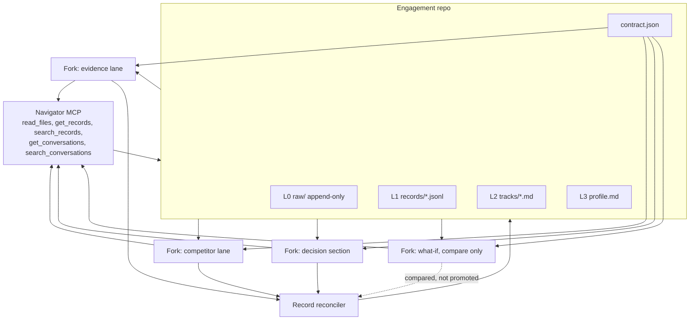

# Strata

Strata is a Git platform for one client engagement at a time. The repository is a [NapMem](https://arxiv.org/abs/2607.05794) memory pyramid. A contract at the root says which agent may write which layer. Agents fork the engagement and work at the same time. The merge is not a line diff. It is a reconcile of typed records: duplicates fold, disagreements stay on the record with both provenances, and a what-if fork is compared and not merged.

This is an entry for [Cloudflare's Git-platform contest](https://www.cloudflare.com/git-competition/). It runs on the ideas in that brief — repos, forks, scoped tokens, and a Worker — and it does not put an agent on top of GitHub pull requests.

The client in the demo is **Northwind Lanterns**, a made-up outdoor-lighting maker. There is no real customer data in this repository.

License: MIT.

## Why it matters: the Norwalk River Valley Trail

The worked example is a proposed network along the Norwalk River Valley Trail in Fairfield County, CT, tied to the Perceptagon art installation: five towns, each with its own agent, sharing one collective record. In a storm week, Redding's sensor reports standing water near the Ridgefield line while a Ridgefield resident says the stretch is passable. Strata keeps both claims on the record as an open conflict with their sources; the contract blocks Wilton's agent from rewriting Redding's record; Norwalk tests longer evening hours on a what-if fork that never touches the shared record; and a trail steward traces both claims and makes the call. This is a proposed deployment, not a live one.

- Concept post: https://strata.shuriq-concept-space.pages.dev
- Same post served from a Cloudflare Artifacts repo via a Worker: https://strata-post.jonny-a6b.workers.dev

## Run it

Local (no Cloudflare account needed, Node 20+):

```
npm install
npm run demo        # Northwind reference scenario
npm run demo:nrvt   # NRVT storm week: five towns, one collective memory
npm test            # 19 tests
```

Live against Cloudflare Artifacts:

```
export ARTIFACTS_DRIVER=cloudflare
export CLOUDFLARE_API_TOKEN=...      # never commit this
export CLOUDFLARE_ACCOUNT_ID=...
export ARTIFACTS_NAMESPACE=strata-demo   # use a fresh test namespace
npm run demo
```

The live demos create (and replace) repos named `northwind-dusk*` and `nrvt-collective*` in that namespace.

### nrvt-storm-week

Five town agents (Norwalk, Wilton, Ridgefield, Redding, Danbury) and a Norwalk what-if agent fork `nrvt-collective` and write at the same time. The run shows Redding's sensor claim and a Ridgefield resident's claim kept as an open conflict, Wilton refused by `contract.json` when it tries to write Redding's record, the evening-hours what-if compared and never merged, a read-only token refused with HTTP 403, and a human steward's decision (storm fund, crew days, hours ruling) committed as a record that cites every claim it relied on. All amounts, IDs, readings and names in this scenario are illustrative, not NRVT data. Requires the Workers Paid plan.

Token permissions (Cloudflare custom API token, scoped to one account):
- Account > Artifacts > Edit (required)
- Account > Workers Scripts > Edit (only to deploy the navigator Worker)
- Account > Cloudflare Pages > Edit (only to deploy the concept post)

## Architecture



`contract.json` is the unit of governance, in the sense of a folder whose root says who may act. Each agent gets a repository token scoped to its own fork. A read token can load the pyramid. It cannot commit. Promotion back into the engagement is a second check against `may_promote`.

Record types on L1 are `claim`, `source`, `evidence`, `instruction`, `preference`, and `event`. A claim carries a `claim_key` and a `stance`. The reconciler folds two claims when the key and the stance match, and unions their source ids. It keeps both when the stances differ, and marks the conflict open for a person. It does not pick a winner.

## Layout of an engagement

```
contract.json
profile.md                 L3  short, length-budgeted
tracks/*.md                L2  one file per report section, linked to record ids
records/*.jsonl            L1  one file per record type
raw/intake/*               L0  append-only
raw/calls/*.json
raw/sources/*.json         source refs addressed by SHA-256
reconcile/manifest.json    written by the reconciler
```

The two lower layers are JSON. The two upper layers are Markdown with a small frontmatter block. Every record has an id, a type, content, a time, and `source_ids`.

## Run locally

Requirements: Node.js 22 or newer, and `git`.

```sh
npm install
npm test
npm run demo
npm run dev
```

`npm run demo` is the contest path. It uses the local Artifacts adapter, which is a directory of real git repositories plus a token file. No Cloudflare account and no API key are required. The command:

1. Creates `northwind-dusk` and commits the pyramid one layer at a time.
2. Answers three navigator questions (top-down, bottom-up, across tracks) with citations.
3. Shows that a read token can read `profile.md` and cannot commit.
4. Forks the engagement to four agents and runs them concurrently.
5. Reconciles at the record layer and commits the result.
6. Writes `.demo/snapshot.json` and prints the provenance trail for the contested Harbor price.

Then open the desk:

[Strata desk](http://127.0.0.1:43123)

The page shows the forks, the merged pyramid, the open conflict, the what-if comparison, and the trail from a claim to its source hash and the commit that authored it. **Run again** repeats the demo.

Other commands:

```sh
npm run seed          # pyramid only, five commits
npm run mcp           # stdio MCP server over the seeded repo
npm run typecheck
```

Optional narration, off by default: `OPENAI_API_KEY=... npm run demo -- --llm`. The merges stay scripted. If the key is missing, the demo still finishes.

## Deploy to a Cloudflare account

Artifacts is on the Workers Paid plan. Billing for Artifacts storage started around 14 October 2026: 10,000 operations and 1 GB a month are included, then $0.15 per 1,000 operations and $0.50 per GB-month. Forks multiply operations. Set a usage alert before a live run.

The Worker entry is `worker/index.ts`. It exposes NapMem's five tools as JSON-RPC at `POST /mcp`, and it mints **read** tokens at `POST /tokens`. It does not push. Pushes are git, with a write token, from a machine that has `git`.

1. Create a namespace, or use `default`. Confirm the name with `npx wrangler artifacts namespaces list` or the dashboard.
2. In `wrangler.jsonc`, replace `YOUR_ARTIFACTS_NAMESPACE`. Do not put an API token in that file.
3. `npm run worker:deploy`
4. Regenerate binding types when you want the generated names: `npm run worker:types`
5. To run the same demo against the account instead of the local adapter:

```sh
export CLOUDFLARE_API_TOKEN=...      # Artifacts Read and Edit
export CLOUDFLARE_ACCOUNT_ID=...
export ARTIFACTS_NAMESPACE=default   # your namespace
export ARTIFACTS_DRIVER=cloudflare
npm run demo
```

That driver deletes and recreates repositories named `northwind-dusk` and `northwind-dusk--*` in the namespace. Point it at a namespace you can wipe. The API token stays in the environment.

Git authentication follows the current docs: the repo token goes in `Authorization: Bearer …`, not in the remote URL. Basic-auth password form, if you need it, uses the token secret with the `?expires=` suffix removed and the username `x`.

After the pyramid exists, the Worker reads it:

```sh
curl -s https://<your-worker>/mcp \
  -H 'content-type: application/json' \
  -d '{"jsonrpc":"2.0","id":1,"method":"tools/call","params":{"name":"search_records","arguments":{"query":"must not","type":"instruction"}}}'
```

Local equivalent, after `npm run demo`:

```sh
curl -s http://127.0.0.1:43123/api/mcp \
  -H 'content-type: application/json' \
  -d '{"jsonrpc":"2.0","id":1,"method":"tools/list"}'
```

## What is real Artifacts, and what is mocked

| Piece | Local demo | Cloudflare account |
|---|---|---|
| Repository, fork, log, readFile, readTree, readBlob, tokens | Exercised. Each repo is a real `git` directory. Tokens are repo-scoped and enforced, including read-only refusal. | Implemented in `lib/store/cloudflare.ts` against the [REST API](https://developers.cloudflare.com/artifacts/api/rest-api/) and git-over-HTTPS. Not called from this environment, because there is no account here. |
| Commit | `git commit` in the repo directory. | `git push` to the Artifacts remote with a write token. |
| Record reconcile, contract checks, navigator | Same code on either driver. | Same code. The Worker navigator reads through the [Workers binding](https://developers.cloudflare.com/artifacts/api/workers-binding/) (`get`, `log`, `readCommit`, `readTree`, `readFile`, `createToken`). |
| `POST /mcp` on the Worker | The Next route `/api/mcp` serves the local repo. | `worker/index.ts` serves the bound namespace. `wrangler dev` without an account returns 503 and points at `npm run demo`. |
| Push events | Not simulated. | Not subscribed. The reconciler runs in the demo process. A `pushed` subscription would be the production wake-up. |

`npm run demo` prints `Driver: local` when it is on the adapter. A Cloudflare run prints `Driver: cloudflare`.

## Tests

```sh
npm test
```

The reconciler tests cover folding, stance conflicts, divergent ids, compare-only forks, track clashes, and promotion refusal. Governance tests cover append-only raw, the profile budget, and token scope. One test runs the four-agent demo.

## Demo video, about eight minutes

Record the terminal in a large font. Use only this synthetic engagement. Cloudflare receives a license to the video, so do not substitute a real client.

| Time | Shot | Say |
|---|---|---|
| 0:00–0:40 | Title card, then `contract.json` | Ten agents checking each other is a review tax. The folder can carry the rule instead. This repository is the memory, and the contract at the root says who may write. |
| 0:40–1:30 | `npm run demo`, pause on the five seed commits | One engagement, one repo. Raw intake, typed records, topic tracks, a short profile. Each layer is its own commit, so the history is the story of the engagement. |
| 1:30–2:30 | Navigator section of the log | "What must the report not do?" The agent reads the profile, searches instruction records, then fetches the call line. It cites `rec_ins_no_price_cut` and `msg_004`. It did not receive the whole engagement in the prompt. |
| 2:30–3:10 | The read-token receipt | A read token loads the profile. The same token is refused on commit: insufficient permissions. Scope is the token, not a convention. |
| 3:10–5:00 | The four agent blocks, then the desk | Evidence, competitor, and the decision section write at the same time, each on a fork. The section writer updates the decision track and is refused the profile, the raw call, and the instruction record. The client's "must not" cannot be edited by the writer. |
| 5:00–6:20 | Conflict and what-if on the desk | Harbor's price is unknown on the market sheet and listed at 86 dollars on a price card. Both claims remain, with sources. The price-cut fork is dashed: it is compared, and it is not merged. |
| 6:20–7:20 | Click the 86-dollar claim | The trail runs claim, source record, SHA-256 snapshot, the competitor's commit, and the reconciler's promote commit. |
| 7:20–8:00 | README, `npm test`, license | Open source, MIT. `npm install && npm run demo` is the whole local path. The Worker binding is the deploy path when you have an account. |

## What this is not

Scoring grammars, rubrics, and brand indexes are not in this repo. `evidence` here is a sourced excerpt, not a score. The agents are deterministic scripts so the demo runs without a model key. An optional `--llm` flag only narrates answers that the scripts already produced.
